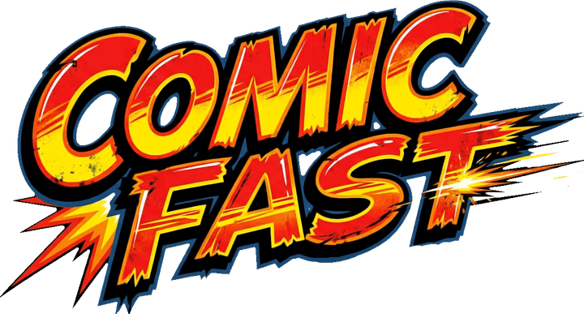

<p align="center"></p>

Editor de cómics **ligero y multiplataforma**.
Tauri 2 (Rust) + Svelte 5 + TypeScript. Sin Electron: el instalador usa el WebView del sistema.

```
┌──────────────────────────────────────────────────┐
│ Archivo  Editar  Página  Ver  Ayuda              │
├────────┬──────────────────────────┬──────────────┤
│ Lista  │ ▢ │                      │ Imágenes│Globos│
│ de     │ ↶ │   PÁGINA (lienzo)    │ Viñetas│Tramas │
│ págs.  │ ⬆ │                      │ Texturas│Grad. │
│        │ ⧉ │   barra lateral      │───────────────│
│        │ … │   de herramientas    │ Propiedades   │
├────────┴───┴──────────────────────┴──────────────┤
│ Comic Fast v0.13.0 · Página 1/1 · 50% · Guardado  │
└──────────────────────────────────────────────────┘
```

## Requisitos

- Node.js 20 o superior
- Rust estable (<https://rustup.rs>)
- Dependencias del sistema de Tauri 2 (en Linux: WebKitGTK, etc.):
  <https://v2.tauri.app/start/prerequisites/>

## Comandos

```bash
npm install
npm run dev          # versión web en http://localhost:1420 (la forma más rápida de iterar)
npm run tauri dev    # aplicación de escritorio con recarga en caliente
npm run check        # tipos (svelte-check)
npm test             # pruebas unitarias (vitest)
npm run build        # versión web lista para publicar en dist/
npm run tauri build  # instaladores de escritorio (ver docs/05-publicar.md)
```

La misma app funciona en el navegador y en Tauri: `src/lib/io/platform.ts` usa
diálogos y archivos nativos dentro de Tauri y descargas/`<input type=file>` en la web.

## Funciones incluidas (versión 0.4)

> El núcleo (historial, geometría, globos, texturas, PDF, formato de archivo) tiene pruebas unitarias.
> La interfaz se prueba a mano: si algo falla en tu sistema, abre un aviso con los pasos.
> Novedades de la 0.4 en [CHANGELOG.md](CHANGELOG.md). **¿Quieres entender el código? Empieza por [docs/](docs/README.md).**

- **Páginas**: añadir, duplicar, eliminar, reordenar arrastrando; 5 tamaños rápidos y **tamaño personalizado** (Página → Tamaño personalizado…: px, mm, cm o pulgadas, 16 formatos habituales, bloqueo de proporción).
- **Apariencia**: tema claro/oscuro y tamaño de la interfaz (A−, A+ y ☀/🌙 en la barra de menú; también en Ver). Por defecto el texto es un 15 % mayor que en la 0.3.
- **Bloqueo**: candado (Ctrl+L, barra lateral o Inspector) en cualquier objeto: no se mueve, redimensiona, gira ni elimina.
- **Globos**: grosor y curvatura de la cola (deslizadores y un tirador blanco en el lienzo).
- **Tramas**: gíralas y escálalas dentro de la viñeta con un mando en el lienzo.
- **Filtros de imagen**: brillo, contraste, saturación, tono, sepia, desenfoque, invertir y teñir (siluetas recoloreables).
- **Recursos propios sin código**: fuentes en `src/assets/fonts/`, imágenes por categorías en `src/assets/resources/` (pestaña «Incluidas», con carpetas desplegables y buscador). Ver [docs/04](docs/04-recursos.md).
- **Multilenguaje**: es, en, ja, ko, fr, zh y pt (botón del globo, idioma del sistema por defecto). Añadir un idioma = soltar un `.json` en `src/locales/`, una guía en `src/locales/guide/` y un EULA en `src/assets/eula/`. Ver [docs/07](docs/07-idiomas.md).
- **Guía de usuario** (Ayuda, F1) y **EULA** (texto provisional) en cada idioma.
- **Pantalla de bienvenida** con el logo y una explicación (Ayuda → Bienvenida; se puede ocultar).
- **Publicación**: versión web estática (Cloudflare/GitHub Pages), instaladores con GitHub Actions, botón de donativo opcional (sin anuncios). Ver [docs/05](docs/05-publicar.md) y [docs/06](docs/06-donativos.md). Sin anuncios.
- **Viñetas**: 12 plantillas de página (incluye cortes en diagonal), viñetas sueltas y **formas**: redonda, elipse, paralelogramo, trapecio, triángulo, rombo, hexágono.
- **Viñetas poligonales**: cualquier viñeta puede convertirse en polígono; arrastra sus vértices, doble clic en un borde añade uno, doble clic en un vértice lo quita.
- **Capas dentro de la viñeta**: varias imágenes, tramas, texturas y degradados a la vez, recortados a la forma. Cada capa se ordena, se oculta con la opacidad y se quita desde el Inspector.
- **Imágenes dentro de la viñeta**: mover, **girar** y escalar en el lienzo (doble clic en la viñeta o Intro; *Alt + arrastrar* mueve directamente).
- **Degradados** lineales y radiales para viñetas y globos, y como capa; con ángulo, centro y colores editables.
- **Texturas**: procedurales (grano, nubes, vetas, manchas, celdas, grietas; con color transparente, intensidad y *Variar*) y de imagen tileable (carpeta `src/assets/textures`).
- **Tramas en SVG**: copia un `.svg` a `src/assets/patterns` (`t_` = mosaico, `n_` = figura) y aparece sola.
- **Degradados con guías** arrastrables en el lienzo y **transparencia** en todos los colores.
- **Degradados reflejado y de puntos, deformar texto, distorsión, arrastrar recursos con el puntero y soltar imágenes en cualquier parte** (`docs/13-degradados-y-deformar.md`).
- **Editor de imágenes, reorganizar páginas, excluir páginas del estilo/numeración, distribuidor, parámetros globales, texto justificado, optimización con imágenes grandes** (`docs/14-editor-de-imagenes-y-mas.md`).
- **Nuevo dibujo, bote de pintura, gota, dedo, puntas de pincel (assets), presión de tableta y plantillas de proyecto** (`docs/15-dibujo-y-plantillas.md`).
- **Móvil y pantalla completa** (solo web): interfaz propia en teléfonos, pellizco para el zoom, modo pantalla completa e instalable en la pantalla de inicio. **Texto vertical** para japonés/chino/coreano. Ver `docs/12-movil-y-vertical.md`.
- **Página de estilo**: márgenes, encabezados, pies y número de página que se repiten en todas las páginas (`docs/11-estilo-y-fuentes.md`).
- **Modos de fusión** (multiplicar, trama/screen, superponer…) en imágenes, tramas, texturas y degradados.
- **Fuentes propias** (TTF/OTF/WOFF/WOFF2) guardadas dentro del proyecto.
- **Menú contextual propio** (clic derecho): cortar, copiar, pegar, duplicar, eliminar.
- **Botón «Obtener versión de escritorio»** en la web, alimentado por `descargas/descargas.json`: ver `docs/09-descargas.md`.
- **Campanita de avisos** (solo web) alimentada por `avisos.json`: ver `docs/08-avisos.md`.
- **Barra lateral** junto al lienzo: deshacer/rehacer, orden de capas (frente, subir, bajar, fondo), duplicar, eliminar, editar imagen, vértices, zoom, cuadrícula e imán.
- **Globos**: diálogo, pensamiento, grito, susurro y narración, con cola arrastrable y texto que se ajusta solo al tamaño.
- **Texto y onomatopeyas** con contorno; **tramas vectoriales**: puntos, líneas, trama cruzada, cuadrícula y líneas de velocidad.
- Selección múltiple, mover, redimensionar, girar, cuadrícula con imán, copiar/pegar/duplicar, orden de capas.
- **Deshacer/rehacer** ilimitado (por comandos) en todas las acciones.
- **Guardar/abrir** `.cfast` y **exportar** PNG, PDF (todas las páginas) y CBZ, a 300 dpi.
- Fuentes empaquetadas (Comic Neue y Bangers, licencia OFL) para que se vea igual en todos los sistemas.

### Atajos

| Acción | Atajo |
|---|---|
| Nuevo / Abrir / Guardar | Ctrl+N / O / S (⌘ en macOS) |
| Deshacer / Rehacer | Ctrl+Z / Ctrl+Shift+Z |
| Copiar / Pegar / Duplicar | Ctrl+C / V / D |
| Eliminar | Supr |
| Editar texto | Doble clic o Intro |
| Editar imagen dentro de la viñeta | Doble clic en la viñeta, o Intro (Esc sale) |
| Orden de capas | Ctrl+↑ / Ctrl+↓ (con Mayús: frente / fondo) |
| Mover con precisión | Flechas (Mayús = ×10) |
| Desplazar la vista | Espacio + arrastrar, o botón central |
| Zoom | Ctrl+rueda, Ctrl+`+` / `-` / `0` / `1` |

## Arquitectura

La idea central: **el documento es solo datos** y todo lo demás lo deriva.

```
src/lib/
  model/        Datos y lógica pura
    types.ts      Documento → Páginas → Objetos (panel con capas, image, balloon, text, pattern)
    store.svelte.ts  Estado del editor (runes) y todas las operaciones
    history.ts    Deshacer/rehacer con el patrón Command (TypeScript puro, con pruebas)
    geometry.ts   Rotación y redimensionado (puro, con pruebas)
    panelGeometry.ts  Polígonos, vértices y capas de viñeta (puro, con pruebas)
  render/       Cómo se dibuja cada cosa
    balloon.ts, patterns.ts, textures.ts, paint.ts, panelShape.ts, textLayout.ts   Geometría, texturas y rellenos (puros, con pruebas)
    fonts.svelte.ts                           Carga de fuentes
  components/   Interfaz Svelte
    PageContent.svelte   ← EL ÚNICO renderizador: lo usan el lienzo, las miniaturas y la exportación
    objects/             Una vista por tipo de objeto (PanelView, LayerView, PaintFill…)
    Toolbar.svelte       Barra lateral de herramientas
    Canvas.svelte        Interacción: selección, arrastre, tiradores, zoom, drag & drop
  resources/registry.ts  Pestañas del panel derecho como datos
  app/actions.ts         Menús y atajos desde una sola lista de acciones
  io/            Archivos
    cfast.ts      Formato de proyecto (ZIP: project.json + assets/)
    pdf.ts        Escritor de PDF propio (sin dependencias)
    render.ts     Rasterizado: monta PageContent → SVG → canvas
    platform.ts   Tauri o navegador
src-tauri/      Rust: solo abre la ventana y registra los plugins de diálogo y archivos
```

### Cómo ampliarlo

| Quiero… | Dónde |
|---|---|
| Un globo, trama, plantilla de página u onomatopeya nueva | Añadir un ítem a `resources/registry.ts` |
| Un comando de menú o atajo nuevo | Añadir una acción en `app/actions.ts` y listarla en un menú |
| Un tipo de objeto nuevo (p. ej. flechas) | Tipo en `model/types.ts` → vista en `components/objects/` → rama en `ObjectView.svelte` → campos en `Inspector.svelte` |
| Una operación nueva que se pueda deshacer | Método en `store.svelte.ts` que use `history.run(...)` |
| Cambiar el formato de archivo | Subir `FORMAT_VERSION` y añadir un paso en `migrate()` de `io/cfast.ts` |

Reglas que mantienen el proyecto simple:

1. Todo cambio del documento pasa por `history` (Command). Los gestos continuos usan `editor.live()` mientras se arrastra y `editor.commit()` al soltar.
2. Los componentes no guardan estado del documento; solo leen `editor` y llaman a sus métodos.
3. Una sola función de dibujo (`PageContent`): lo que ves es lo que se exporta.

### Formato `.cfast`

Es un ZIP (se puede abrir con cualquier descompresor). Versión actual del formato: 2 (los proyectos de la 0.1 se migran solos al abrirlos):

```
project.json          páginas, objetos (viñetas con capas), tamaño y un índice de imágenes
assets/<id>.<ext>     imágenes originales, sin recomprimir
```

Solo se guardan las imágenes que alguna página usa.

## Próximos pasos sugeridos

1. Probar en las tres plataformas (en Linux, WebKitGTK puede renderizar algo distinto a WebView2/WKWebView).
2. Reducir imágenes enormes al importarlas (p. ej. máx. 3000 px) para mantener ligeros los proyectos.
3. Formas vectoriales sueltas (línea, flecha) y más herramientas de viñeta (voltear, alinear, distribuir).
4. Filtros de efecto cómic (posterizar, bordes, medios tonos) con WebGL o Rust/WASM.
5. Paquetes de recursos externos (carpetas con `manifest.json`) que alimenten `resources/registry.ts`.
6. Autoguardado y recuperación tras cierre inesperado.
7. Integración de IA generativa (generar imágenes de viñeta, sugerir texto): un módulo `src/lib/ai/` con una interfaz de proveedor, sin acoplar el resto.
8. Menús nativos y versión móvil/tableta (Tauri 2 ya soporta iOS y Android).
